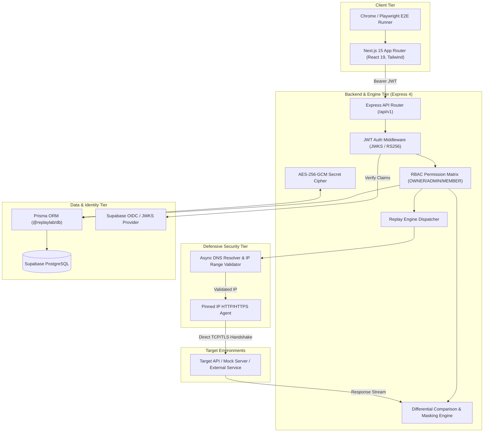

# ReplayLab

<div align="center">

[](https://github.com/Aniketkoppaka/ReplayLab/actions/workflows/ci.yml)
[](LICENSE)
[](https://www.typescriptlang.org/)
[](https://nextjs.org/)
[](https://nodejs.org/)
[](https://www.postgresql.org/)
[](https://www.prisma.io/)

**Enterprise-grade API fixture capture, deterministic playback, and differential regression testing engine.**

[Live Staging Web UI](https://replay-lab-gilt.vercel.app) • [Staging API](https://replaylab-api-staging.onrender.com) • [Architecture](#architecture) • [Getting Started](#quick-start) • [Security & SSRF](#security--ssrf-defense) • [API Reference](#api-endpoints)

</div>

---

## Overview

Modern software development relies heavily on third-party APIs, distributed microservices, and webhook lifecycles. When downstream APIs change payloads, update schemas, or suffer regressions, automated tests often fail to catch the breakage until staging or production breaks.

**ReplayLab** solves this by providing:
- **Sanitized Fixture Capture**: Store full HTTP interactions (methods, paths, query parameters, headers, and request bodies) with automated redaction of sensitive credentials.
- **Pinned-IP Dispatcher**: Replay requests deterministically against target environments while actively blocking Server-Side Request Forgery (SSRF) and DNS rebinding attacks.
- **Differential Response Comparison**: Compare status codes, headers, and response payloads against baseline snapshots.
- **JSONPath Masking**: Eliminate false alarms caused by non-deterministic dynamic fields (timestamps, UUIDs, trace IDs, HMAC signatures).
- **Regression Suite Orchestration**: Bundle fixtures into executable test suites run sequentially or on demand.

---

## Live Deployments

| Component | Target URL | Status Probe | Details |
| :--- | :--- | :--- | :--- |
| **Web Dashboard** | [`https://replay-lab-gilt.vercel.app`](https://replay-lab-gilt.vercel.app) | N/A | Next.js 15 App Router on Vercel |
| **Replay Engine API** | [`https://replaylab-api-staging.onrender.com`](https://replaylab-api-staging.onrender.com) | [`GET /health`](https://replaylab-api-staging.onrender.com/health) | Express 4 on Render container environment |
| **Readiness Check** | [`https://replaylab-api-staging.onrender.com/ready`](https://replaylab-api-staging.onrender.com/ready) | `HTTP 200` | Verifies DB pool & 256-bit AES master key |
| **Identity & Database** | [`https://cxcgxttvsyfqszfhcjao.supabase.co`](https://cxcgxttvsyfqszfhcjao.supabase.co) | Supabase Cloud | Managed PostgreSQL 16 + OIDC JWKS Auth |

---

## Architecture

ReplayLab is built as an ultra-strict TypeScript monorepo using `pnpm` workspaces:



### Workspace Structure

```
ReplayLab/
├── apps/
│   ├── api/                 # Express backend, safe replay dispatcher, AES crypto
│   └── web/                 # Next.js 15 App Router frontend (React 19, Tailwind CSS)
├── packages/
│   ├── contracts/           # Shared domain models, DTO types, and Zod schemas
│   ├── db/                  # Prisma schema, migrations, and PostgreSQL client
│   └── config/              # Shared ESLint, Prettier, and TypeScript configurations
├── infra/
│   ├── database/            # Local Docker Compose config for PostgreSQL 16
│   └── demo-api/            # Deterministic mock server for local replay verification
├── e2e/                     # Synthetic local mock & authenticated staging Playwright journeys
└── docs/                    # Architectural decision records (ADRs) & threat models
```

---

## Key Features

### 1. Deterministic Fixture Playback
- Replay exact HTTP interactions across multiple environments (`local`, `staging`, `preview`, `production`).
- Support for `NONE`, `JSON`, and `TEXT` body types.
- Strict payload limits (10MB request/response limit) and enforced socket timeouts (15s maximum execution).

### 2. Differential Comparison & JSONPath Masking
- Byte-accurate header, status code, and body comparisons.
- Mask dynamic values using dot-notation or JSONPath (e.g. `user.id`, `meta.timestamp`, `session.token`) to ensure deterministic test runs.

### 3. Comprehensive Anti-SSRF Defense
Outbound HTTP replay requests present severe security risks if not isolated. ReplayLab enforces:
- **Strict Scheme Allowlist**: Only `http:` and `https:` schemes allowed.
- **Pre-Resolution DNS Inspection**: Asynchronously resolves target hostnames and blocks:
  - RFC 1918 Private ranges (`10.0.0.0/8`, `172.16.0.0/12`, `192.168.0.0/16`)
  - Loopback (`127.0.0.0/8`, `::1`)
  - Cloud metadata endpoints (`169.254.169.254`, IPv6 equivalents)
  - Carrier-grade NAT (`100.64.0.0/10`), link-local, broadcast, and multicast.
- **Pinned Socket Connections**: Custom Node.js HTTP/HTTPS agents connect directly to the pre-validated IP address while setting TLS SNI to the target hostname. This **eliminates DNS rebinding TOCTOU vulnerabilities**.
- **Hop-by-Hop Redirect Revalidation**: Redirects are rejected by default or re-evaluated against the IP filter at every hop.

### 4. Cryptographic Secret Protection (AES-256-GCM)
- Target environment variables (such as `API_KEY` or `BEARER_TOKEN`) marked as secret are encrypted at rest using **AES-256-GCM** with unique 12-byte initialization vectors (IVs) and 16-byte authentication tags.
- Secrets are masked (`[ENCRYPTED]`) in API responses and decrypted only in-memory during safe request dispatching.

### 5. Multi-Tenant Project Isolation & 404 Non-Disclosure
- Role-Based Access Control (`OWNER`, `ADMIN`, `MEMBER`, `VIEWER`).
- Requests attempting to access resources belonging to other tenants fail with a clean `404 Not Found`, completely preventing resource existence enumeration.

---

## Technology Stack

| Layer | Technology | Details |
| :--- | :--- | :--- |
| **Language** | TypeScript 5.7+ | Strict typing across all packages; 0 implicit `any` |
| **Frontend** | Next.js 15.5, React 19 | App Router, Tailwind CSS 4, Lucide Icons |
| **Backend** | Node.js 22/24, Express 4.21 | Modular router, fail-closed middleware, async error traps |
| **Data & ORM** | PostgreSQL 16, Prisma 6.3 | Fully typed database wrapper, migrations, relation integrity |
| **Validation** | Zod 3.24 | Shared request/response validation schemas (`@replaylab/contracts`) |
| **Auth & OIDC** | `jose` (v6), Supabase Auth | JWKS asymmetric RS256/ES256 verification + local HS256 fallback |
| **Testing** | Vitest 3.2, Playwright 1.64 | 229 unit/integration tests + cross-browser E2E suites |
| **Monorepo** | `pnpm` 9.15.5 | Managed via Corepack; strict workspace dependency links |

---

## Quick Start

### Prerequisites
- **Node.js**: `22.x` or `24.x` (LTS; see `.nvmrc`)
- **Package Manager**: `pnpm@9.15.5` enabled via Corepack (`corepack enable pnpm`)
- **Docker** *(optional)*: For local PostgreSQL container

### 1. Clone & Install
```bash
git clone https://github.com/Aniketkoppaka/ReplayLab.git
cd ReplayLab
corepack pnpm install --frozen-lockfile
```

### 2. Configure Environment
Copy the example environment configuration:
```bash
cp .env.example .env
```
The `.env.example` file contains safe development defaults and non-sensitive mock keys.

### 3. Build & Verify Monorepo
```bash
# Generate Prisma Client & compile shared packages
corepack pnpm --filter @replaylab/db run prisma:generate
corepack pnpm --filter @replaylab/contracts --filter @replaylab/db run build

# Run static quality gates
corepack pnpm typecheck
corepack pnpm lint

# Execute all unit and integration tests
corepack pnpm test
```

### 4. Start Local Development
```bash
# Terminal 1: Start Express API server (port 3001)
corepack pnpm --filter @replaylab/api dev

# Terminal 2: Start Next.js Web UI (port 3000)
corepack pnpm --filter @replaylab/web dev
```
Navigate to `http://localhost:3000` to interact with the platform.

---

## Testing & Quality Gates

ReplayLab enforces continuous, evidence-based quality verification across multiple testing tiers:

```bash
# Typecheck: Strict zero-warning verification across all 5 workspace projects
pnpm typecheck

# Lint: ESLint across all packages with 0 warnings allowed
pnpm lint

# Unit & Integration: 207 tests covering crypto, SSRF IP filtering, comparison engine, etc.
pnpm test

# Local Mock Playwright E2E: 7 browser user journeys against local mock server
pnpm test:e2e

# Staging-Authenticated Playwright E2E: 7 live tests against deployed Vercel & Render
# Requires staging test user: PLAYWRIGHT_STAGING_USER_EMAIL=... PLAYWRIGHT_STAGING_USER_PASSWORD=...
pnpm test:e2e:staging

# Production Monorepo Build: Full tsc compilation + optimized Next.js 15 bundle
pnpm build
```

> **Note on Database Tests**: Tests requiring live PostgreSQL connection pool operations (`postgres-live.test.ts` and `postgres-live-lifecycle.test.ts`, totaling 22 tests) run automatically in GitHub Actions CI where PostgreSQL 16 is spun up as a service container. In local development without Docker, they are cleanly skipped.

---

## API Endpoints

All endpoints except `/health` and `/ready` require a valid Bearer JWT:

### Health & Readiness Probes
- `GET /health`: Liveness probe for container orchestrators.
- `GET /ready`: Readiness probe verifying PostgreSQL connection and 256-bit encryption key length.

### Projects & Members
- `GET /api/v1/projects`: List active user projects.
- `POST /api/v1/projects`: Create a new project workspace.
- `GET /api/v1/projects/:projectId`: Get project details.
- `PATCH /api/v1/projects/:projectId`: Update project name/settings.
- `DELETE /api/v1/projects/:projectId`: Delete project and cascade dependent resources.
- `GET /api/v1/projects/:projectId/members`: List team members and roles.
- `POST /api/v1/projects/:projectId/members`: Add a user with role (`OWNER`, `ADMIN`, `MEMBER`, `VIEWER`).
- `DELETE /api/v1/projects/:projectId/members/:memberId`: Remove project member.

### Environments & Secrets
- `GET /api/v1/projects/:projectId/environments`: List configured target environments.
- `POST /api/v1/projects/:projectId/environments`: Create environment (e.g. Staging, Preview).
- `PATCH /api/v1/projects/:projectId/environments/:envId`: Update base URL and variables.
- `DELETE /api/v1/projects/:projectId/environments/:envId`: Delete environment.

### Fixtures & Baselines
- `GET /api/v1/projects/:projectId/fixtures`: List saved request fixtures.
- `POST /api/v1/projects/:projectId/fixtures`: Capture/create an HTTP fixture.
- `GET /api/v1/projects/:projectId/fixtures/:fixtureId`: Get fixture specification.
- `POST /api/v1/projects/:projectId/fixtures/:fixtureId/baseline`: Update baseline snapshot.
- `DELETE /api/v1/projects/:projectId/fixtures/:fixtureId`: Delete fixture.

### Replay Execution & Regression Suites
- `POST /api/v1/projects/:projectId/replay`: Trigger interactive playback of a fixture against an environment.
- `GET /api/v1/projects/:projectId/runs`: List replay execution run history.
- `GET /api/v1/projects/:projectId/runs/:runId`: Inspect detailed run diff and assertion result.
- `POST /api/v1/projects/:projectId/suites`: Create a regression suite.
- `POST /api/v1/projects/:projectId/suites/:suiteId/run`: Execute complete regression suite with abort signaling.

---

## Security & SSRF Defense

ReplayLab takes a defense-in-depth approach to API replay security:

```
+----------------------------------------------------------------------------------+
|                            SAFE DISPATCHER PIPELINE                              |
+----------------------------------------------------------------------------------+
| 1. URL Scheme Check      -> Must strictly be 'http:' or 'https:'                 |
| 2. Async DNS Resolution  -> Resolves host via OS/custom DNS lookup               |
| 3. IP Blocklist Filter   -> Blocks RFC1918, 127/8, 169.254/16, CGNAT, IPv6 loopback |
| 4. Socket Pinning        -> Net/TLS socket connects directly to validated IP     |
| 5. TLS ServerName        -> Sets SNI to original hostname for valid cert checks |
| 6. Payload Limits        -> Rejects outbound bodies > 10MB; stream caps on read  |
| 7. Execution Timeouts    -> 3s connect timeout, 15s overall execution timeout    |
+----------------------------------------------------------------------------------+
```

---

## Demo Walkthrough Checklist

To demonstrate ReplayLab live:
1. **Sign In**: Navigate to [https://replay-lab-gilt.vercel.app/login](https://replay-lab-gilt.vercel.app/login) and sign in.
2. **Project Selection**: Select or create an active project.
3. **Environment Setup**: Add an environment (e.g. `Staging API` pointing to `https://replaylab-api-staging.onrender.com/api/v1`).
4. **Fixture Capture**: Add a fixture (`GET /status/200`) with baseline status `200`.
5. **Interactive Replay**:
   - Trigger playback.
   - Verify execution badge **`SUCCESS`**, exact status **`HTTP 200`**, and 100% differential baseline match.
6. **Negative Assertion**:
   - Edit baseline to expect `400`.
   - Re-run playback to observe immediate, deterministic **`ASSERTION_FAILURE`** detection.

---

## Contributing & License

Contributions, bug reports, and suggestions are welcome. Please read [CONTRIBUTING.md](CONTRIBUTING.md) and [SECURITY.md](SECURITY.md) before submitting pull requests.

Distributed under the **MIT License**. See [`LICENSE`](LICENSE) for details.
